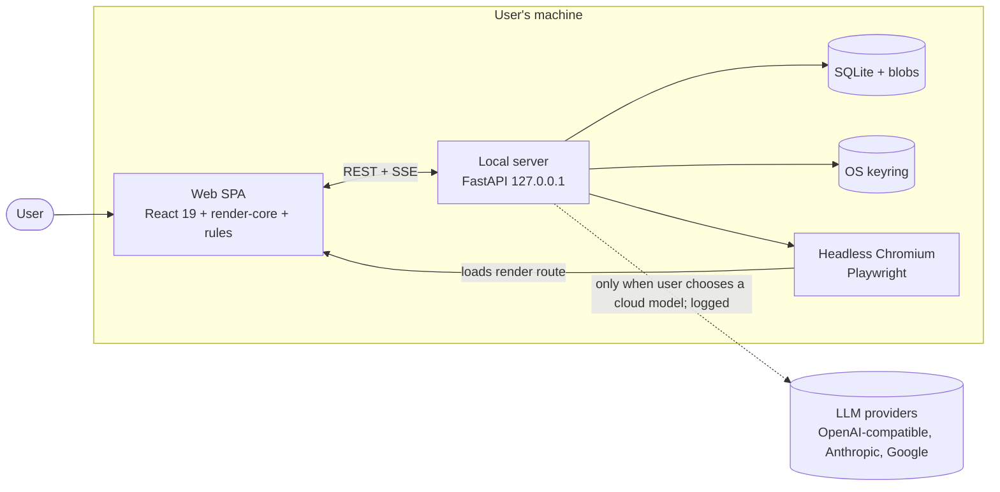
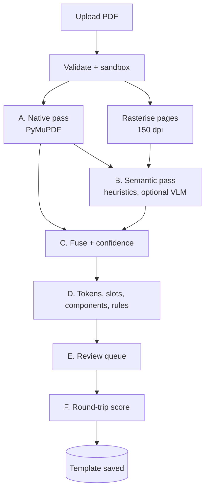
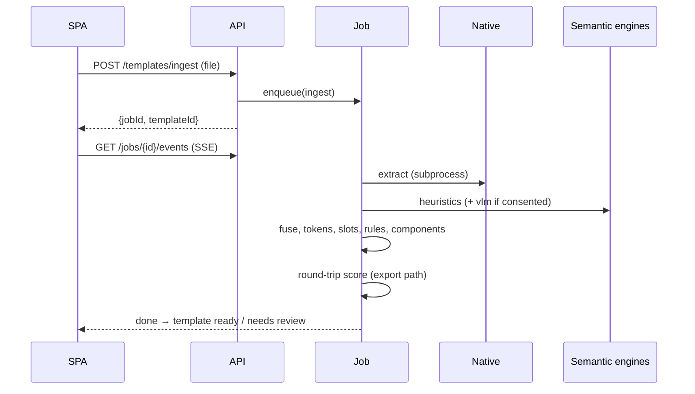
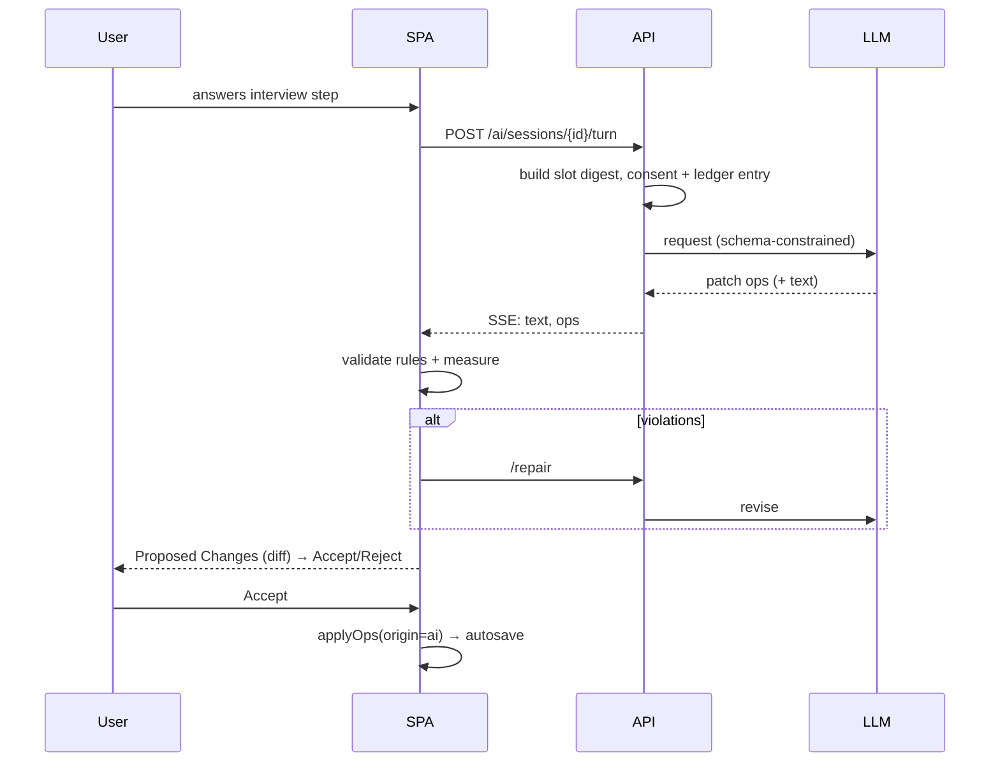

# Templix — System Architecture

Version 0.1 · Audience: the coding agent and maintainers · Companion docs: `design.md`,
`functional-requirements.md`, `non-functional-requirements.md`, `dependencies.md`, `decisions.md`.
Decisions are referenced as `D-0xx`.

---

## 1. Purpose and scope

Templix lets a person upload an **old reference document** (a magazine/newsletter/report PDF), turns it
into a **layered, rule-aware template**, and then lets them **recreate a new document** by changing only
the content. Two authoring modes share one engine:

- **Manual Edit:** auto-generated form sidebar + live preview.
- **AI Assist:** an interview that drafts content into the template's slots using a model of the user's
  choice (bring-your-own API key). Local models come later (D-029).

The core promise: *design, structure, hierarchy and rules stay locked; only content changes; a tiny edit
costs a tiny amount of compute and tokens.*

Out of scope for v1: see D-020.

## 2. Architectural principles

1. **Document = data** (D-002). No component ever "regenerates the file".
2. **Template ≠ Content** (D-003). Edits to content cannot corrupt design.
3. **One renderer** (D-008). Preview and export share code.
4. **Measure, don't assert** (D-023). Every quality number shown to the user is computed.
5. **Humans confirm, machines propose.** AI and parsers produce proposals with confidence; the user
   accepts.
6. **Local by default, explicit when not** (D-012). Anything that leaves the machine is announced and
   logged.
7. **Adapters at every volatile edge:** layout engines, OCR, LLM providers, exporters.
8. **Boring infrastructure:** SQLite, in-process jobs, SSE. No brokers, no containers required to run.

## 3. System context and containers



| Container | Responsibility | Tech |
|---|---|---|
| Web SPA | All UI, preview, rules, text-fit measurement, patch generation for manual edits | Vite, React 19, TS, Tailwind v4 |
| Local server | Upload, ingestion jobs, persistence, AI orchestration, key vault, export orchestration | FastAPI, Pydantic v2 |
| Store | Metadata + op-log in SQLite; large files content-addressed on disk | SQLite (WAL), filesystem |
| Vault | Provider secrets | `keyring` (+ encrypted-file fallback) |
| Render browser | Produces PDFs from the same render route the SPA uses | Playwright + Chromium |

## 4. Repository layout (D-025)

```
templix/
├─ apps/
│  ├─ web/                    # Vite SPA (routes = screens, see design.md §8)
│  └─ server/                 # uv project
│     └─ templix/
│        ├─ api/              # routers, deps, auth/session token, SSE
│        ├─ model/            # Pydantic domain models (source of truth, D-015)
│        ├─ ingest/
│        │  ├─ native/        # PyMuPDF extractor (AGPL boundary, D-007)
│        │  ├─ semantic/      # engines: heuristics, vlm (later: docling, paddle, glm-ocr)
│        │  ├─ fuse.py        # fusion + confidence
│        │  ├─ tokens.py      # style-token inference
│        │  ├─ components.py  # repeating-component detection
│        │  └─ fidelity.py    # round-trip scoring
│        ├─ ai/               # providers/, interview/, patches/, digest.py, ledger.py
│        ├─ export/           # playwright runner
│        ├─ vault/            # keyring + fallback
│        ├─ store/            # SQLAlchemy, migrations, blob store
│        ├─ jobs/             # job runner, progress events
│        └─ fonts/            # resolver, font index
├─ packages/
│  ├─ doc-schema/             # generated: TS types + JSON Schemas (do not hand-edit)
│  ├─ render-core/            # nodes → DOM, text-fit, font loading
│  ├─ rules/                  # rule evaluators + fix suggestions
│  └─ ui/                     # design-system components + Tailwind tokens (design.md)
├─ design/stitch/             # immutable Stitch export (visual contract)
├─ docs/                      # these specifications
├─ fixtures/                  # public/synthetic fixtures; `fixtures/private/` is git-ignored
└─ e2e/                       # Playwright tests incl. visual regression
```

## 5. Domain model

### 5.1 Three tiers (D-003)

```
Template  ── layers, tokens, slots, components, rules, provenance, fidelity report
Content   ── slot values + repeater instances (+ asset references)
Document  ── {templateId, templateVersion, content, overrides, status}
```

### 5.2 Coordinates and units

- Units are **PDF points** (1/72 in). Origin **top-left**, y grows **down** (the extractor converts from
  PDF's bottom-left origin once, at the boundary).
- A node's `bbox = {x, y, w, h}` is its **layout box** in page space. Rotation (degrees) is applied around
  the box centre.
- Rendering maps 1 pt → 1 CSS px at 72 dpi logical scale; zoom is a CSS transform on the page container.
- Colours are stored as `#RRGGBB` (+ optional alpha). Source colour spaces (CMYK/ICC) are converted at
  ingestion and the original is kept in `provenance` for later print workflows.

### 5.3 Node types

All nodes share: `id` (ULID), `type`, `role`, `name`, `bbox`, `z`, `rotation`, `locked` (cannot be moved or
deleted), `editable` (content may change through a slot), `visible`, `confidence` (0–1), `provenance`
(source refs: page, PDF object ids, engine names), `groupId?`.

| `type` | Payload | Typical `role` values |
|---|---|---|
| `text` | `styleRef` (token) or inline style, `runs` (default content), `fit`, `align`, `columns?` | `title`, `heading1`, `heading2`, `body`, `byline`, `caption`, `quote`, `header`, `footer`, `pagenum`, `label` |
| `image` | `assetId`, `crop`, `fitMode` (`cover`/`contain`), `aspectLock`, `minDpi` | `photo`, `logo`, `figure`, `background` |
| `shape` | `path` (SVG path data or primitive), `fill`, `stroke`, `strokeWidth`, `dash`, `radius` | `rule`, `divider`, `box`, `decoration`, `band` |
| `table` | `rows × cols` of cell nodes (v1: simple grid; flagged "read-only" when irregular) | `table` |
| `group` | `children[]` | `section`, `card`, `sidebox`, `masthead` |
| `flow` | A text node whose content flows across `columns` (count, gap, rule) inside a fixed box | `body` |

`role` is a controlled vocabulary shared by the parser, the rules engine, and the AI digest.

### 5.4 Slots, components, repeaters

- A **slot** binds one or more nodes (or a field of a node) to a content key: `Slot{id, nodeIds[], field,
  label, kind, constraints, required, section}`. Several `nodeIds` = a *shared* slot (running header/footer,
  issue number repeated on every page): one edit updates all bound nodes in one transaction. `kind ∈ text | richtext | image | date | link | choice`.
- **Constraints** are derived at ingestion from the original: `maxChars`, `maxLines`, `maxWords`, `fit`
  policy, `aspect`, `minDpi`. They are editable in the Rules tab.
- A **component** is a reusable group with its own slots (e.g. *article card*, *event row*). Detected by
  repeated structurally similar groups (§6.4) or defined by the user.
- A **repeater** places N instances of a component inside a container: `Repeater{id, componentId,
  containerNodeId, direction (stack|grid), gap, min, max, overflow (flag|clip|new-page—P2)}`. Instances live
  in Content (`instances[repeaterId][]`).
- **Sections** group slots for the sidebar and the interview (`Cover & Masthead`, `Lead Editorial Story`,
  `Articles & Highlights`, …) — inferred from page position + roles, user-editable.

### 5.5 Style tokens and rules

- `tokens.colors`, `tokens.fonts` (family, weight, style, source), `tokens.textStyles` (font, size, leading,
  tracking, colour, transform), `tokens.spacing` (margins, gutters, baseline grid).
- `rules[]`: `{id, scope (global|page|role|node), kind, params, severity (error|warn|info), message}`.
  Kinds: `maxChars`, `maxLines`, `minFontSize`, `allowedFonts`, `minContrast`, `safeMargin`,
  `requiredOnEveryPage`, `imageMinDpi`, `aspectLock`, `noOverflow` (D-017). Inferred defaults are
  proposed at ingestion, never silently enforced until the user accepts them.

### 5.6 JSON skeleton (illustrative, not exhaustive)

```jsonc
{
  "schemaVersion": 1,
  "template": {
    "id": "01J…", "name": "Campus Chronicle", "version": 3,
    "source": { "fileName": "…pdf", "sha256": "…", "pageCount": 2, "kind": "pdf" },
    "tokens": {
      "colors": { "ink": "#191919", "accent": "#0A66C2" },
      "fonts": { "display": { "family": "Playfair Display", "weights": [700], "source": "google" } },
      "textStyles": { "title": { "font": "display", "size": 28, "leading": 34, "tracking": -0.5, "color": "ink" } }
    },
    "pages": [ { "id": "p1", "size": { "w": 612, "h": 792 }, "nodes": [
      { "id": "n_title", "type": "text", "role": "title", "bbox": { "x": 48, "y": 64, "w": 516, "h": 48 },
        "styleRef": "title", "locked": false, "editable": true, "confidence": 0.97,
        "fit": { "mode": "shrink", "minScale": 0.9, "maxLines": 1 }, "runs": [ { "text": "CAMPUS CHRONICLE" } ] }
    ] } ],
    "sections": [ { "id": "s_cover", "label": "Cover & Masthead", "slotIds": ["sl_title"] } ],
    "slots": [ { "id": "sl_title", "nodeIds": ["n_title"], "kind": "text", "label": "Masthead title",
                 "constraints": { "maxChars": 24, "maxLines": 1 }, "required": true } ],
    "components": [], "repeaters": [],
    "rules": [ { "id": "r1", "scope": "role:body", "kind": "minFontSize", "params": { "pt": 9 }, "severity": "error" } ],
    "fidelity": { "pages": [ { "ssim": 0.981, "pixelDiff": 0.006, "textIoU": 0.97 } ], "overall": 0.975 }
  },
  "content": {
    "values": { "sl_title": [ { "text": "CAMPUS CHRONICLE", "marks": [] } ] },
    "instances": { },
    "assets": { }
  }
}
```

### 5.7 Versioning and migration

`schemaVersion` on every persisted object; forward migrations are pure functions in
`apps/server/templix/model/migrations/`. Template edits create a new `version`; Documents pin the version
they were authored against and are offered an upgrade (diff shown) when a newer one exists.

## 6. Ingestion pipeline (reference study)



All stages run as a **job** (§12.3) emitting progress events (`stage`, `percent`, `message`) over SSE.
Each stage persists its output so that failures can resume and so that the analysis screen can show partial
results.

### 6.1 Validate and sandbox (stage 0)
Check magic bytes, size ≤ 50 MB, page count ≤ 50 (soft), encryption (reject password-protected with a clear
message). Parsing happens in a **subprocess** with CPU-time and memory limits and a wall-clock timeout
(NFR-SEC-*). The PDF is never opened by anything that executes embedded JavaScript.

### 6.2 Native pass (A)
Using PyMuPDF behind the `NativeExtractor` port:
- **Text:** `get_text("dict")` spans → `{text, font, size, flags, color, bbox, origin}`; join to lines/blocks.
  Record raw font names and whether the font is embedded/subset.
- **Images:** `get_image_info` + `extract_image` → store content-addressed assets with bbox, transform,
  effective dpi, soft masks.
- **Vectors:** `get_drawings` → paths with fill/stroke/width/dash/opacity/clip; collapse rectangles and
  lines to primitives; keep complex paths as SVG path data.
- **Page boxes, rotation, background fill, links, annotations.**
Output: `NativeDoc` (typed, serialisable, ≈ the PDF's own truth).

### 6.3 Semantic pass (B)
Goal: assign **roles**, **reading order**, **grouping**, and detect **tables/columns**.
Engines (D-006), chained by confidence:
1. **`heuristics` (always):** cluster font sizes/weights into a typographic hierarchy; detect running
   header/footer (repeats across pages, near margins); detect columns by x-histogram; detect captions by
   proximity to images; detect rules/dividers/boxes from vectors; detect lists and bylines by patterns.
2. **`vlm` (opt-in, consent):** send the page raster (and a compact JSON of native boxes with ids) to the
   user's vision-capable model; ask for a **structured labeling** (`{nodeId → role, groupId, readingOrder}`
   plus unlabeled-region proposals). The model **labels existing boxes**; it does not invent geometry.
3. *(Phase 2+)* `docling` / `pp-doclayout` / `paddleocr-vl` / `glm-ocr` adapters supply regions and
   reading order from open models, benchmarked on our corpus (D-006, D-023).

### 6.4 Fusion, grouping, components (C, D)
- **Fuse:** match semantic regions to native elements by IoU and text similarity; native geometry wins
  (D-005). Unmatched semantic regions become *review items*; unmatched native elements keep heuristic roles.
- **Confidence per node:** `min(role_agreement, geometry_sanity, font_resolution)` where
  `role_agreement` = agreement between engines (or heuristic margin when only one ran),
  `geometry_sanity` penalises overlaps/zero-area/out-of-page, `font_resolution` = resolver certainty (§7.3).
  **Template confidence** = area-weighted mean. The banner "Analysis N % confident — K items need review"
  is computed from these, never fixed.
- **Validators (produce review items):** WCAG contrast < 4.5:1 for body/3:1 for large text, unresolved
  font, text clipped by its box, overlapping text nodes, image below minimum dpi, irregular table.
- **Token inference:** cluster colours (ΔE < 3 merge), text styles, margins and gutters, baseline grid.
- **Slots and constraints:** for each editable role create a slot with constraints measured from the
  original (lines, chars-per-line, capacity).
- **Component detection:** find groups with similar structure (same child roles, similar relative boxes)
  repeated ≥ 2 times; propose a component + repeater; the user confirms.

### 6.5 Round-trip fidelity score (F) — D-023
For each page: rasterise the reference at 144 dpi; render the template **with its original content** through
the export path (§7.4) at the same dpi; compute:
- `ssim` — structural similarity on luminance (scikit-image).
- `pixelDiff` — fraction of pixels differing by > 16/255 after a 1-px tolerance dilation, ignoring regions
  flagged "photo" (photos are compared by SSIM only).
- `textIoU` — mean IoU between reference text-line boxes and rendered text-line boxes (via a headless DOM
  `getClientRects` dump).
`pageScore = 0.5·ssim + 0.3·(1 − pixelDiff) + 0.2·textIoU`. Overall = mean. Initial bands: **≥ 0.97
Excellent · 0.93–0.97 Good · < 0.93 Needs review**; thresholds are tuned on the fixture corpus and stored in
config. The UI shows the number, per-page score, and a diff heatmap overlay. Scores below the band raise the
template status to *Needs review*.

### 6.6 Review queue (E)
Items are `{id, kind, nodeIds, severity, suggestion, autoFix?}`. The Layer Analysis screen lists them under
"Review items"; "Accept all detected" accepts every suggestion with confidence ≥ 0.8 and leaves the rest.
Every user correction (role change, bbox edit, merge/split, lock/unlock) is a **patch** (D-016) on the
Template and is persisted.

## 7. Rendering and export

### 7.1 `render-core`
Pure TS, framework-agnostic with a thin React binding. Input: *resolved document* = Template + Content +
overrides → `Page[]` of absolutely positioned elements. Rules:
- Text is rendered as DOM text nodes inside positioned boxes using the token styles; spans from Content
  (D-028) become `<strong>/<em>/<a>` created via DOM APIs, never `innerHTML`.
- Images use `object-fit` + crop transforms; shapes render as inline SVG.
- Every element carries `data-node-id` for hit-testing, overlay boxes, and click-to-field (FR-MAN-*).
- The page container sets `width/height` in px = points; print CSS uses `@page { size: <w>pt <h>pt; margin:0 }`.

### 7.2 Text fitting
Per text node/slot `fit` policy:
- `none`: render as-is; overflow raises a `noOverflow` violation.
- `shrink`: binary-search font-size scale in `[minScale, 1]` until content fits box (measured with
  `scrollHeight`/`getClientRects` after `document.fonts.ready`); beyond `minScale` it becomes a violation.
- `clamp`: limit to `maxLines` with an ellipsis (discouraged; off by default).
- `flow`: for `flow` nodes, content fills CSS columns (`column-count`, `column-gap`, `column-rule`,
  `column-fill: auto`) in a fixed-height box; overflow raises a violation.
Measurement runs in the browser only (no duplicate implementation). The server never measures text.

### 7.3 Fonts (D-018)
`FontResolver` (server) builds a **font index** from bundled fonts, user fonts, and the cached Google Fonts
set. For each PDF font name: strip subset prefix → normalise → exact/alias match → fuzzy match
(`rapidfuzz`) on family+style → metric check (advance-width comparison on a pangram vs the PDF's glyph
widths) → certainty score. Result: `{requested, resolved, source, certainty}`. Fonts are delivered to the
SPA/export page as `@font-face` from the local server (`/fonts/:id`). Missing fonts surface as review items
with actions *Upload font file* / *Use suggested*.

### 7.4 Export
`POST /documents/:id/export {format:"pdf"}` creates a job: the server opens the **render route**
(`/render/:docId?token=…&mode=print`) in headless Chromium, waits for `window.__templixReady === true`
(fonts loaded, images decoded, fit complete), runs the **rules gate** inside the page (errors block export
unless the user overrides, FR-EXP-*), then `page.pdf({width, height, printBackground:true, preferCSSPageSize:true})`.
Fonts are embedded by Chromium. The result is stored as an artifact and downloaded by the SPA. PNG export
uses `page.screenshot`. Determinism: fixed viewport/DPR, disabled animations, pinned Chromium build.

## 8. Editing engine (SPA)

- **Store (Zustand + Immer):** `{template, content, selection, ui, rulesReport}`. Mutations go through
  `applyOps(ops, origin)` where `origin ∈ user | ai | system`. Immer yields forward/inverse patches.
- **Undo/redo:** stacks of inverse patches grouped by transaction (typing is coalesced per field per 800 ms).
- **Autosave:** ops are batched (≤ 500 ms) and POSTed to `/documents/:id/ops`; the server validates, stores
  in the op-log and periodically snapshots. The UI shows *Auto-saved locally* with real state
  (`saving | saved | error`). On reconnect the SPA replays unsent ops.
- **Rules:** `rules` package evaluates the resolved document after each transaction (debounced to the next
  animation frame for cheap rules, 150 ms for measure-based rules) and returns a report keyed by node/slot.
- **Selection model:** clicking a node in the preview selects its slot; the sidebar scrolls/focuses the field
  (and vice-versa). In Template-edit mode, selection exposes the Layer Inspector.
- **Concurrency:** single user, single writer. A document open in two tabs shows a read-only lock banner
  (BroadcastChannel + server lease).

## 9. AI subsystem

### 9.1 Provider port (D-009)
```python
class LLMProvider(Protocol):
    id: str                                   # "openai" | "anthropic" | "google" | "openai_compat"
    async def list_models(self) -> list[ModelInfo]: ...
    async def test(self) -> TestResult: ...   # cheap auth + reachability + latency
    async def complete(self, req: LLMRequest) -> LLMResult: ...
    def stream(self, req: LLMRequest) -> AsyncIterator[LLMEvent]: ...

class LLMRequest(BaseModel):
    model: str; system: str; messages: list[Msg]          # Msg may carry images (bytes + mime)
    response_schema: dict | None; max_output_tokens: int; temperature: float | None
    cache_prefix_messages: int = 0                        # hint for providers that support caching
```
`LLMResult` returns text/parsed JSON, token counts (input, output, cached), latency, provider request id.

### 9.2 Capabilities and structured-output ladder
Capabilities (`vision`, `structured: native|tool|json_object|none`, `context`, `max_output`, price) come
from `model-capabilities.json` + provider metadata (D-027). Strategy per call, highest first:
1. **native JSON-schema** output; 2. **forced tool call** whose parameters are the schema; 3. `json_object`
mode with schema in the prompt; 4. plain text with a fenced JSON block.
Always validate with Pydantic; on failure send one **repair message** containing the validation errors;
max 2 repairs. Never execute or `eval` model text.

### 9.3 Interview planner (deterministic)
Input: template `sections` and their slots. State machine persisted per document:
`plan = [section → step(s)]`; each step has `{sectionId, prompt, expects: "keep|replace|skip" + payload}`.
The progress header ("Step 3 of 7 · 45 %") is simply `index/len(plan)`. For each section the assistant:
1. Shows the current content, asks what to do (*Keep / Replace / Skip* quick-reply chips).
2. If *Replace*: collects raw material (typed notes, pasted text, attached files/images — text extracted
   server-side).
3. Calls the model with the **slot digest** (§9.4) restricted to that section → receives **patch ops**.
4. Runs the **fit loop** (§9.5), then presents a **Proposed Changes** card for Accept/Reject.
The LLM may phrase questions, but the *what to ask next* logic is code, which keeps cost and behaviour
predictable and testable.

### 9.4 Slot digest (context packing)
The model never receives the whole template. It receives, per section:
```json
{ "style_guide": ["Title ≤ 65 chars, ≤ 2 lines", "Tone: neutral, third person", "Dates as 'May 12, 2025'"],
  "slots": [ { "id": "sl_lead_headline", "label": "Story Headline", "kind": "text",
               "constraints": { "maxChars": 65, "maxLines": 2 },
               "current": "New Local AI Laboratories Open for Collaborative Research Projects",
               "role": "heading1" } ],
  "user_material": "…notes the user typed/pasted…" }
```
Target ≤ 2–4 k input tokens per call for a typical newsletter (NFR-COST-*). The stable prefix (system prompt +
patch schema + style guide) comes first so provider prompt caching applies. Page images are **not** sent in
authoring mode (only in the opt-in `vlm` ingestion pass).

### 9.5 Fit loop
`propose → SPA validates (rules + measure) → violations? → POST /ai/repair {opId, violations} → model revises
→ validate` up to 2 times; then the proposal is shown with its remaining warnings (never silently
truncated). Violations are phrased compactly: `slot sl_lead_headline: 3 lines, limit 2; 78 chars, limit 65`.

### 9.6 Patch contract
```jsonc
// model output (validated)
{ "ops": [
  { "op": "replace", "path": "/content/values/sl_lead_headline", "value": [ {"text":"Spring Student Innovation Showcase to Feature 40 Tech Projects","marks":[]} ] },
  { "op": "replace", "path": "/content/values/sl_deadline_date", "value": [ {"text":"Friday, May 2 at 11:59 PM","marks":[]} ] }
] }
```
Server-side checks before anything reaches the user: path ∈ allowlist (`/content/values/<editable slot>`,
`/content/instances/…`, never `/template/**` in AI mode), value schema matches slot `kind`, size limits,
link scheme allowlist, image ops only reference assets the user supplied.

### 9.7 Usage, cost, streaming
Every call writes to the **usage ledger** (tokens in/out/cached, model, price snapshot → estimated cost).
Settings shows per-provider spend for the current period; the AI header shows live latency. Streaming uses
SSE events `token`, `ops`, `usage`, `done`, `error`. Users can **cancel** (client aborts, server closes the
upstream request).

## 10. Security and privacy architecture

### 10.1 Threat model (summary)

| # | Threat | Control |
|---|---|---|
| T1 | Another website attacks `localhost` API (CSRF/DNS-rebinding) | Bind `127.0.0.1`; per-launch random session token required on every request (cookie `SameSite=Strict` + header); strict `Host` and `Origin` allowlist; no permissive CORS |
| T2 | API key theft by page script or from disk | Keys only in OS keyring/encrypted file; write-only API; redaction in logs/errors; no keys in DB, files, URLs, or analytics (none exist) |
| T3 | Malicious PDF exploits parser | Subprocess sandbox, resource limits, timeouts, no JS execution, pinned/updated PyMuPDF, fuzz-ish fixtures |
| T4 | Prompt injection in document text or pasted notes | §10.4 |
| T5 | XSS via model/user text | No HTML storage (D-028); DOM text nodes; link allowlist; CSP `default-src 'self'` (+ fonts/images from self); `frame-ancestors 'none'` |
| T6 | SSRF through provider "custom base URL" | Admin-style validation: URL scheme http(s) only; warn on non-HTTPS non-localhost; disallow link-local/metadata IPs (169.254.0.0/16); request made only by the server to the configured host |
| T7 | Unintended data egress | Consent dialog + data-flow ledger + indicator (D-012) |
| T8 | Supply-chain compromise | Lockfiles with hashes, `pip-audit`/`pnpm audit` in CI, minimal deps (`dependencies.md`), pinned Chromium |
| T9 | Data loss/corruption | SQLite WAL + atomic file writes (temp + rename) + op-log + periodic snapshot + export/import |

### 10.2 Local server hardening
- On launch: generate a 256-bit token, print a one-time URL `http://127.0.0.1:<port>/#t=<token>`; the SPA
  exchanges it for an HttpOnly, SameSite=Strict cookie and drops it from the URL.
- Reject requests whose `Host` is not `127.0.0.1:<port>`/`localhost:<port>`; reject cross-origin
  state-changing requests; require a custom header (`X-Templix-Token`) for mutating calls.
- Security headers: CSP, `X-Content-Type-Options`, `Referrer-Policy: no-referrer`, `Cross-Origin-Opener-Policy`.
- Uploads: stream to temp, size cap, content-type sniffing; filenames never used as paths.

### 10.3 Key vault (D-010)
`VaultPort.get/set/delete(provider_id, label)`; implementations: `KeyringVault`, `PassphraseFileVault`.
The server loads a key into memory only for the duration of a request. `GET /providers` returns
`{id, label, last4, status, lastTestedAt}`.

### 10.4 Prompt injection and untrusted content
Document text and user notes are **data**. Controls: wrap in clearly delimited blocks and instruct the
model they are untrusted; **no tools** other than "return patch ops"; output is schema-validated and
allow-listed to editable slots (§9.6), so an injected "ignore previous instructions" cannot delete layers,
exfiltrate keys (models never see them), or call URLs; every AI change needs explicit **Accept**; links in
proposals are shown with their destination.

### 10.5 File handling
Originals and derived assets are content-addressed (`sha256`) under `TEMPLIX_HOME/blobs/`. Deleting a
template deletes unreferenced blobs. "Delete all data" in Settings → Privacy wipes DB + blobs (keys
optionally).

### 10.6 Data-flow ledger
Table `egress_log(id, ts, provider, model, doc_id, kind[text|image|both], items, bytes, tokens_in,
tokens_out, request_id)`. Written **before** the outbound request (intent) and updated after. Visible and
exportable (CSV). The status-bar indicator derives from the *current mode*: manual/native → "No data leaves
this device"; AI/VLM with a cloud model → "Sends slot text to <Provider>".

## 11. API surface (REST + SSE)

Base `/api/v1`. All JSON unless noted. Errors: RFC 7807 problem details with `code` + `hint`.

| Area | Method & path | Purpose |
|---|---|---|
| Session | `POST /session` | Exchange launch token for cookie |
| System | `GET /status` | engine ready, versions, RAM, parser version, privacy mode |
| Templates | `GET /templates` · `GET/PATCH/DELETE /templates/{id}` | Library CRUD (filters: kind, status, q) |
| | `POST /templates/ingest` (multipart) | Start ingestion → `{jobId, templateId}` |
| | `GET /templates/{id}/analysis` | Layers, tokens, rules, review items, fidelity |
| | `POST /templates/{id}/ops` | Apply template patch ops (validated) |
| | `GET /templates/{id}/pages/{n}/reference.png` | Reference raster |
| | `POST /templates/{id}/rescore` | Re-run fidelity |
| | `GET /templates/{id}/package` · `POST /templates/import` | `.templix` zip export/import |
| Documents | `POST /documents {templateId}` · `GET /documents?…` · `GET/PATCH/DELETE /documents/{id}` | Lifecycle |
| | `POST /documents/{id}/ops` · `GET /documents/{id}/history` | Autosave op-log, section history |
| | `POST /documents/{id}/export` → job · `GET /artifacts/{id}` | PDF/PNG export |
| Assets | `POST /assets` · `GET /assets/{id}` | User images |
| Fonts | `GET /fonts` · `POST /fonts` · `GET /fonts/{id}` · `POST /fonts/resolve` | Font manager |
| Providers | `GET /providers` · `PUT /providers/{id}` (config) · `PUT /providers/{id}/key` · `DELETE …/key` | Write-only keys |
| | `POST /providers/{id}/test` · `GET /providers/{id}/models` | Test connection, list models |
| AI | `POST /ai/sessions {documentId}` · `GET /ai/sessions/{id}` | Interview state |
| | `POST /ai/sessions/{id}/turn` (SSE) | User message → streamed assistant text + proposed ops |
| | `POST /ai/sessions/{id}/repair` (SSE) | Fit-loop repair |
| Privacy | `GET /privacy/ledger` · `GET /privacy/ledger.csv` · `POST /privacy/wipe` | Transparency |
| Jobs | `GET /jobs/{id}` · `GET /jobs/{id}/events` (SSE) | Progress |

## 12. Storage

### 12.1 Layout
```
TEMPLIX_HOME/                       (default: %APPDATA%/Templix, ~/Library/Application Support/Templix, ~/.local/share/templix)
  templix.db                        SQLite (WAL)
  blobs/ab/cdef…                    content-addressed: originals, page PNGs, images, fonts, artifacts
  logs/                             rotating, redacted
  fonts-cache/
```
### 12.2 Tables (indicative)
`templates(id, name, status, version, json, fidelity, created_at, updated_at)` ·
`template_versions(template_id, version, json)` · `documents(id, template_id, template_version, title,
status, json, updated_at)` · `document_ops(id, document_id, seq, ops_json, origin, ts)` ·
`document_snapshots(document_id, seq, json)` · `jobs(id, kind, state, progress, payload, result, error, ts)` ·
`providers(id, kind, label, base_url, default_model, last4, status, tested_at)` ·
`usage_ledger(...)` · `egress_log(...)` · `fonts(id, family, style, source, blob, license)` ·
`settings(key, value)`.
### 12.3 Jobs
`JobRunner` with named queues (`ingest`, `export`, `score`), a `ProcessPoolExecutor` for CPU-bound work, and
event fan-out to SSE. Jobs are idempotent per input hash; on server start, `running` jobs are marked
`interrupted` and offered "Resume".

## 13. Key sequences

### 13.1 Ingest

### 13.2 AI edit


## 14. Errors, observability, operations
- Typed errors with user-facing `hint` ("This PDF is password protected — remove the password and retry").
- Structured logs (JSON) with request ids; redaction filter for secrets and document text (text logged only
  at `DEBUG` and never by default).
- `GET /status` powers the footer status bar (*Engine Ready · RAM · Parser version · privacy mode*).
- Health of the headless browser is probed at startup; failures degrade export with an actionable message.

## 15. Extensibility points

| Port | v1 adapters | Later |
|---|---|---|
| `NativeExtractor` | PyMuPDF | pypdfium2/pdfminer |
| `LayoutEngine` | heuristics, vlm | docling, pp-doclayout, paddleocr-vl, glm-ocr |
| `OcrEngine` | — | rapidocr, tesseract, vlm |
| `LLMProvider` | openai, anthropic, google, openai_compat | ollama preset, lm-studio preset |
| `Exporter` | pdf, png | docx (best effort), pdf/a |
| `InputNormaliser` | pdf | docx via LibreOffice |

## 16. Phasing (maps to milestones in `AGENT_PROMPT.md`)

| Phase | Outcome |
|---|---|
| **P1 — MVP** | Native ingestion + heuristic roles + review UI, manual editor, PDF export, fidelity score, provider settings with key vault, AI Assist with patches and fit loop |
| **P2** | VLM labeling, scanned PDFs/OCR, DOCX input, multi-column polish, font manager UX, component/repeater detection, Devanagari verification, add-page overflow |
| **P3** | Multi-reference master templates, rules mining, local models (Ollama), Tauri packaging, template package sharing, DOCX export (best effort) |
